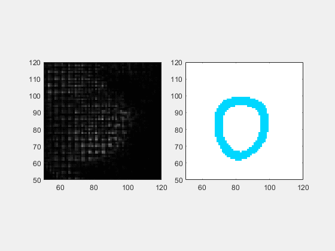
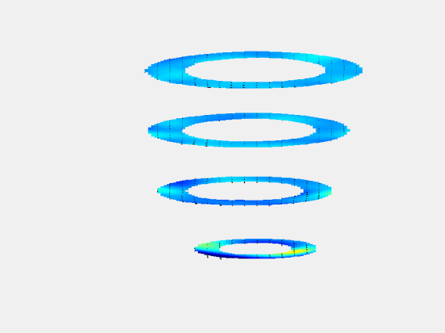

# HARP-I
HARP-I (Harmonic Phase Interpolation) is a method that utilizes radial basis function interpolation to recover tissue motion from 2D and 3D tagged MR images.

<p align="center">
  
  
</p>

HARP-I comes in two implementations, either of which can be used on its own:

| | |
|---|---|
| :m: **MATLAB toolbox**, in `src/` | the original, and the reference the Python port is checked against |
| :snake: **Python package**, in `python/` | the same pipeline as a library and a command line tool, with a graphical interface over the whole of it |

The two agree to about 1e-9 at every stage. Pick whichever suits you.

---

# :snake: Python

```sh
git clone git@github.com:hmella/HARP-I.git
cd HARP-I
pip install -e 'python[gui]'     # or just python, for the library alone
```

Then, from a script:

```python
import harpi

ds = harpi.load_mat_2d("data/data_2D.mat")
flt = harpi.HarpFilter2D(ds.image, ds.ke, (0.0, 3.14159 / 2))
res = harpi.estimate_motion_2d(flt(ds.image), ds.mask, a=ds.suggested_a)
```

from the shell:

```sh
harpi info data/data_2D.mat
harpi process data/data_2D.mat -o out.mat
```

or open the interface, which covers reading the data through to regional
strain:

```sh
harpi gui
```

:book: **[python/README.md](python/README.md)** documents the library, the
command line and every tab of the interface.

The package needs Python 3.10 or newer. PySide6 is only required for the
interface, and `import harpi` does not pull it in.

---

# :m: MATLAB

## Installing unwrapping functionalities

HARP-I relies on the unwrapping algorithm implemented in the **DENSEanalysis** toolbox. However, any unwrapping procedure can be used. The unwrapping algorithm is available in the [DENSEanalysis repository](https://github.com/denseanalysis/denseanalysis/tree/main).

To install **DENSEanalysis** and access its unwrapping functionalities, follow these steps:

1. Clone the repository:
   ```sh
   git clone https://github.com/denseanalysis/denseanalysis.git
   ```
2. Navigate to the **DENSEanalysis** folder:
   ```sh
   cd denseanalysis/
   ```
3. Open **MATLAB** and run:
   ```matlab
   DENSEsetup
   ```

## Toolbox installation
To install **HARP-I**, follow these steps:

1. Clone the repository:
   ```sh
   git clone git@github.com:hmella/HARP-I.git
   ```
2. Navigate to the **HARP-I** folder:
   ```sh
   cd path/to/HARP-I
   ```
3. Open **MATLAB** and run:
   ```matlab
   HARPIsetup
   ```

### Search path order

DENSEanalysis ships an incompatible `pixelstrain`, and a copy of
`parseinputs`. MATLAB resolves a name to whichever directory comes first on
the search path, so adding DENSEanalysis after HARP-I makes the demos fail
with:

```
Error using pixelstrain
Invalid spline data.
```

`HARPIsetup` adds DENSEanalysis first and HARP-I last, and reports any
HARP-I function that is still shadowed. If you manage the path yourself:

```matlab
harpi_paths                                             % find DENSEanalysis
harpi_paths('DENSEanalysis', '/path/to/denseanalysis')  % or give its location
```

## Examples  
HARP-I includes demo scripts showcasing its application to **2D and 3D tagged MR images**. These can be found in the `examples/` folder.  

:file_folder: Inside this folder, you will also find a `README` file that provides additional explanations about the demo scripts and their usage.  

---

# :floppy_disk: Data

`data/data_2D.mat` is in the repository, so the 2D demos and the Python test
suite work from a fresh clone with nothing else to fetch.

`data/data_3D.mat` is 1.3 GB and is **not** in the repository. The `README`
inside `data/` has the download link. Nothing breaks without it: the 3D demos
need it, and the handful of tests that use it skip with a message saying so.

## Citing

If you use **HARP-I** in your research, please cite the following publication:

:newspaper: *H. Mella et al., **HARP-I: A Harmonic Phase Interpolation Method for the Estimation of Motion From Tagged MR Images** in IEEE Transactions on Medical Imaging, vol. 40, no. 4, pp. 1240-1252, April 2021. doi: [10.1109/TMI.2021.3051092](https://ieeexplore.ieee.org/document/9320570).*

---

## Contact

For questions, feedback, or collaboration opportunities, feel free to reach out:

:mortar_board: **Hernán Mella**  
:round_pushpin: Pontificia Universidad Católica de Valparaíso  
✉️ [hernan.mella@pucv.cl](mailto:hernan.mella@pucv.cl)  

---

## License

This source code is licensed under the **Mozilla Public License, Version 2.0 (MPL-2.0)**. If a copy of the MPL was not distributed within this repository, you can obtain one at [http://mozilla.org/MPL/2.0/](http://mozilla.org/MPL/2.0/).